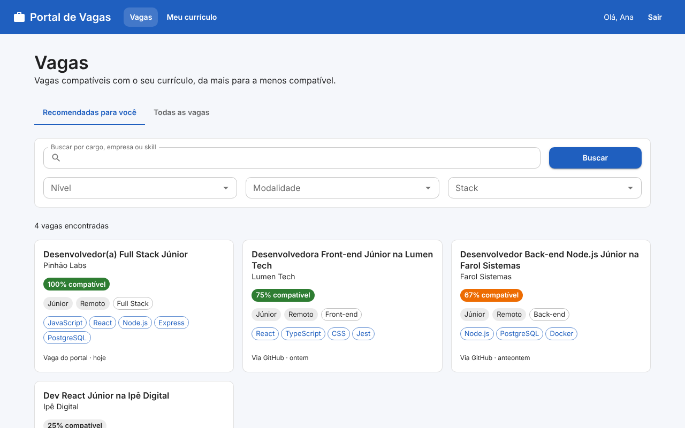
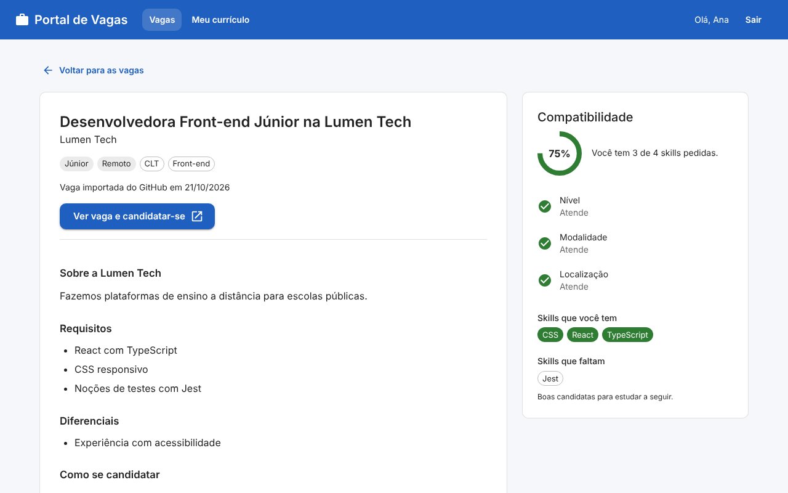
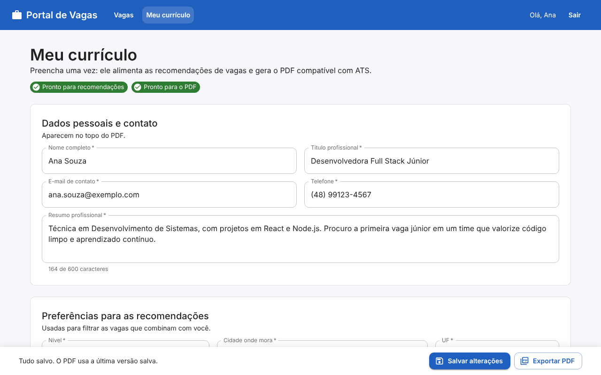
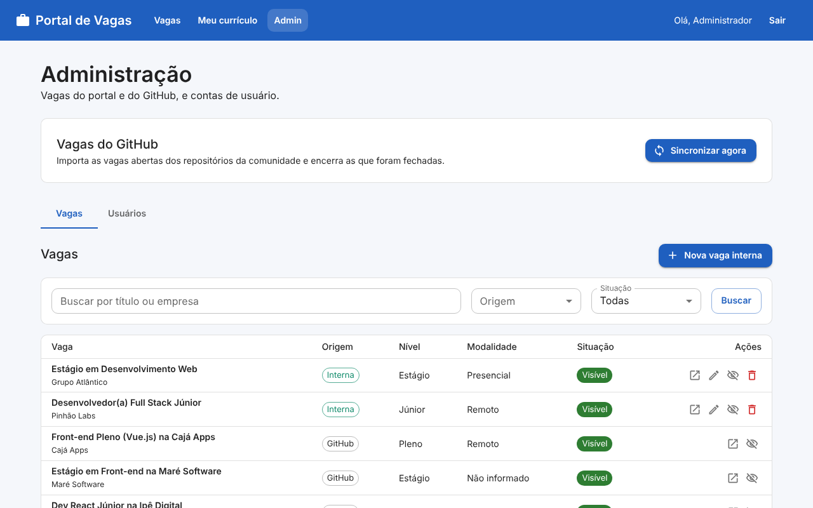
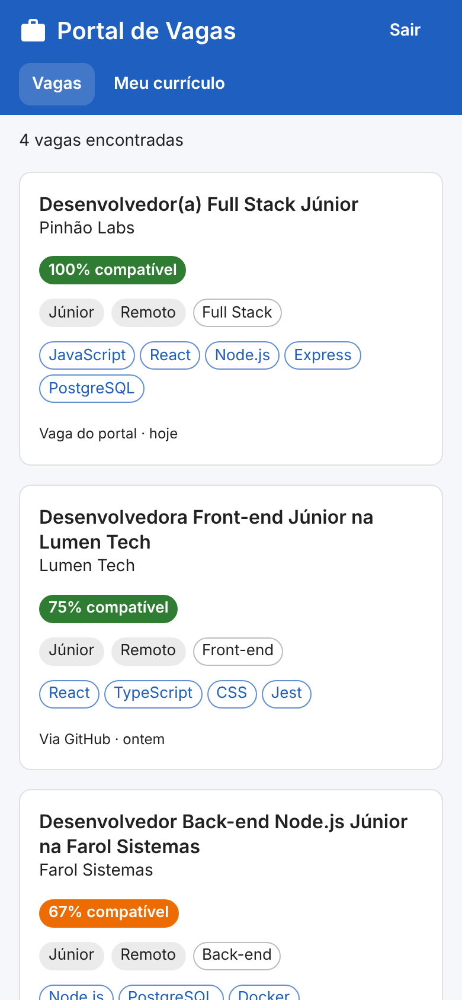

# Portal de Vagas

Portal agregador de vagas de tecnologia, no estilo Indeed, focado em quem está começando a carreira. O candidato preenche o currículo uma única vez, recebe vagas ordenadas por compatibilidade com o seu perfil, vê quais requisitos atende e quais faltam, e exporta o currículo em PDF compatível com ATS.

> **Status:** MVP implementado, com backend e frontend. O fluxo completo foi testado com PostgreSQL pelo navegador, no computador e no celular. A publicação usa Supabase e Vercel: veja o [passo a passo do deploy](./docs/deploy.md) e o [Status e roadmap](#status-e-roadmap).

## Problema

Pessoas em início de carreira em tecnologia têm dificuldade para encontrar vagas aderentes ao seu perfil. As vagas existem, mas são difíceis de encontrar e filtrar, e o currículo muitas vezes não está adequado ao que a vaga pede.

## Solução

- **Vagas agregadas** de repositórios da comunidade no GitHub, normalizadas em um único modelo.
- **Currículo estruturado**, preenchido uma vez e reaproveitado em qualquer candidatura.
- **Match por compatibilidade**: vagas ordenadas pela % de skills que o candidato atende.
- **Exportação em PDF compatível com ATS**, gerado a partir dos dados do formulário.

## Acesse o portal

<p align="center">
  <br>
  Aponte a câmera do celular para acessar o portal
</p>

## Telas

Prints com dados fictícios.

**Vagas recomendadas:** ordenadas pela compatibilidade com o currículo, com busca e filtros.



**Detalhe da vaga:** a % de compatibilidade, os critérios que o currículo atende e as skills que faltam.



**Currículo:** formulário preenchido uma vez, que alimenta as recomendações e gera o PDF compatível com ATS.



**Administração:** sincronização com o GitHub, vagas internas, vagas ocultas e contas de usuário.



**No celular:**



## Perfis de acesso

| Perfil              | Responsabilidades                                                                                      |
| ------------------- | ------------------------------------------------------------------------------------------------------ |
| Usuário (candidato) | Preenche e exporta o CV, recebe vagas recomendadas, busca e filtra vagas, acessa o link de candidatura |
| Admin               | Gerencia usuários e vagas, incluindo o cadastro de vagas internas                                      |

## Escopo do MVP

### Vagas

- **Fontes:** issues dos repositórios `frontendbr/vagas` e `backend-br/vagas`, importadas pela API REST do GitHub, com possibilidade de ampliar as fontes por stack e região em `backend/src/config/fontesVagas.js`. Atualmente, apenas esses dois repositórios estão configurados.
- **Mapeamento de labels:** uma tabela por fonte traduz as labels de cada repositório ("Júnior", "Junior", "Jr") para valores padronizados de nível, tipo de contratação, modalidade e stack.
- **Modelo híbrido:** uma única tabela de vagas com campo de origem (`github` ou `interna`) e link de candidatura, para que empresas entrem no futuro sem retrabalho.
- **Skills da vaga:** identificadas pelas labels do GitHub e pela busca, no texto da descrição, das skills cadastradas.
- **Candidatura por link externo:** o usuário é redirecionado para a página da vaga.
- **Busca e filtros:** por texto, nível, modalidade e stack.

### Currículo

- **Formulário estruturado (estilo Gupy):** contato, resumo, experiências, formação, cursos, skills, nível, modalidade, localização, idiomas e links (GitHub, LinkedIn, portfólio).
- **Skills como tags normalizadas:** tabela única com autocomplete, usada no CV e nas vagas.
- **Exportação em PDF compatível com ATS.**

### Match

1. **Filtros eliminatórios:** a vaga só é recomendada se nível, modalidade e localização forem compatíveis com o CV. Vagas remotas servem para qualquer localização.
2. **Pontuação:** `skills da vaga que o usuário tem ÷ total de skills da vaga × 100`.
3. **Ordenação:** maior compatibilidade primeiro.
4. **Exibição:** o card mostra a %; o detalhe mostra as skills que o usuário tem e as que faltam.

### Admin

- Gerencia usuários (listar, desativar, reativar).
- Cadastra, edita e remove vagas internas, e oculta ou reexibe vagas de qualquer origem. Vagas importadas do GitHub não podem ser editadas nem excluídas pelo admin, pois são mantidas pela sincronização.

### Segurança

- Autenticação com JWT e senhas protegidas com bcrypt.
- Autorização por papel (`admin` e `usuario`).
- Validação de entradas com Zod e tratamento centralizado de erros.
- Helmet, CORS e limites de requisição.
- CPF cifrado com AES-256-GCM e hash determinístico para unicidade.

Detalhes em [mvp/mvp.md](./mvp/mvp.md) e diagramas dos fluxos em [mvp/user-flows.md](./mvp/user-flows.md).

## Status e roadmap

| Área | Situação | Detalhe |
| --- | --- | --- |
| Autenticação e conta | Implementado | Cadastro, login (JWT), perfil, troca de senha e desativação. CPF salvo cifrado (AES-256-GCM) e com hash para unicidade |
| Administração de usuários | Implementado | Listar, desativar e reativar (perfil `admin`) |
| Skills | Implementado | Tabela única, seed inicial e autocomplete |
| **Currículo (CRUD)** | **Implementado** | `POST`, `GET` e `PUT /curriculo`, com validação Zod e gravação em transação |
| Exportação do currículo em PDF | Implementado | `GET /curriculo/pdf`, compatível com ATS |
| Vagas: busca, recomendação e detalhe | Implementado | Filtros, paginação e match por compatibilidade |
| Documentação da API | Implementado | Swagger em `/docs`, com todas as rotas documentadas |
| Integração com o GitHub | Implementado | Sincronização manual por `POST /admin/vagas/sincronizar`, com criação, atualização e inativação de vagas. Agendamento ainda não implementado |
| Admin: gestão de vagas | Implementado | Listar vagas, cadastrar, editar e remover vagas internas, além de ocultar e reexibir vagas de qualquer origem |
| Frontend | Implementado | React, Vite e MUI: cadastro, login, vagas recomendadas e busca, detalhe com match, currículo com PDF e administração. Funciona no celular |
| Deploy | Preparado | API e front na Vercel, banco no Supabase. Passo a passo em [docs/deploy.md](./docs/deploy.md) |

Além dos 164 testes automatizados do backend, que rodam sem banco, o fluxo completo foi testado de ponta a ponta com PostgreSQL pelo navegador: cadastro, login, currículo e PDF, busca e recomendações, detalhe da vaga, sincronização (com o GitHub simulado), vagas internas e administração de usuários.

Pendências técnicas conhecidas:

- O `sequelize.sync()` cria as tabelas que faltam, mas **não altera** tabelas existentes. Não há migrations: mudou um model, é preciso recriar ou alterar a tabela à mão.
- As rotas de editar o perfil, trocar a senha e desativar a própria conta existem, mas ainda não têm tela no front.
- Concluir os ajustes de currículo combinados pelo time: tamanhos dos campos no model, telefone armazenado só com dígitos, modalidades sem `ARRAY(ENUM)` e situação `incompleto` no lugar de `trancado`. A implementação atual ainda usa telefone formatado, `ARRAY(ENUM)` e `trancado`; model, validação, PDF, Swagger e testes devem ser atualizados em conjunto.
- Implementar o agendamento da sincronização, caso o time mantenha a rotina automática prevista no fluxo do sistema.
- A exportação em PDF carrega o currículo com uma função própria (`carregarCurriculoCompleto`), parecida com a do `curriculo.service.js`. Dá para unificar depois.

Funcionalidades fora do MVP (empresas, importação de CV em PDF, match semântico etc.) estão em [mvp/mvp.md](./mvp/mvp.md).

## Stack

| Camada         | Tecnologia                          |
| -------------- | ----------------------------------- |
| Runtime        | Node.js (ES Modules)                |
| API            | Express 5                           |
| Banco de dados | PostgreSQL + Sequelize              |
| Autenticação   | JWT (`jsonwebtoken`) e `bcryptjs`   |
| Validação      | Zod                                 |
| Segurança      | Helmet, CORS e `express-rate-limit` |
| PDF            | PDFKit                              |
| Documentação   | Swagger (OpenAPI 3) via `swagger-jsdoc` |
| Testes         | `node:test` (runner nativo do Node) |
| Frontend       | React 19 + Vite                     |
| Interface      | MUI (Material UI)                   |
| Rotas do front | React Router                        |
| Descrição das vagas | `react-markdown`, com o HTML sanitizado |
| Hospedagem     | Vercel (API e front) e Supabase (PostgreSQL) |

## Estrutura do projeto

```
portal_vagas/
├── backend/
│   ├── .env.example
│   ├── package.json
│   ├── vercel.json             # região da função na Vercel (São Paulo)
│   ├── scripts/                # scripts manuais de apoio (GitHub, labels e sincronização de vagas)
│   ├── src/
│   │   ├── app.js              # entrada da aplicação (exporta o app para a Vercel)
│   │   ├── config/             # database, cors, helmet, rate limit, swagger, fontes e mapeamento de labels
│   │   ├── constants/          # enums compartilhados (nível, modalidade, UF, grau...) e limites do currículo
│   │   ├── controllers/        # auth, usuário, admin, skills, vagas, currículo e PDF
│   │   ├── middlewares/        # autenticação JWT, autorização por papel, validação com Zod e erros
│   │   ├── models/             # modelos Sequelize e associações (index.js)
│   │   ├── routes/             # rotas da API (com a documentação @openapi)
│   │   ├── schemas/            # schemas de validação (Zod)
│   │   ├── seeds/              # carga inicial (admin e skills)
│   │   ├── services/           # regras de negócio: auth, currículo, match, vagas, PDF e GitHub
│   │   └── utils/              # cripto, CPF, normalização de texto, serializadores, LIKE seguro e paginação
│   └── tests/                  # testes automatizados
├── frontend/
│   ├── .env.example
│   ├── package.json
│   ├── vercel.json             # rewrite das rotas do React Router
│   ├── README.md               # detalhes do front: rotas, estrutura e convenções
│   └── src/
│       ├── api/                # cliente HTTP e chamadas por recurso
│       ├── components/         # componentes compartilhados (card de vaga, campo de skills, markdown...)
│       ├── contexts/           # sessão do usuário (AuthContext)
│       ├── hooks/              # useAuth, useApi e useDebounce
│       ├── pages/              # telas: login, cadastro, vagas, detalhe, currículo e admin
│       └── utils/              # máscaras e formatação
├── docs/
│   ├── deploy.md               # passo a passo do deploy (Supabase + Vercel)
│   └── prints/                 # prints usados neste README
├── mvp/
│   ├── mvp.md                  # escopo do MVP
│   └── user-flows.md           # fluxos em Mermaid
├── .nvmrc                      # versão do Node (22)
├── LICENSE
└── README.md
```

## Como rodar

### Pré-requisitos

- Node.js 22. O front usa Vite 8, que não roda no Node 18. Com o nvm, `nvm use` na raiz lê o `.nvmrc`.
- PostgreSQL em execução, com um banco criado para a aplicação

### Backend

```bash
git clone <url-do-repositorio>
cd portal_vagas/backend
npm install
cp .env.example .env
```

No PowerShell, use `Copy-Item .env.example .env` para copiar o arquivo.

Preencha o `.env`:

| Variável            | Obrigatória | Descrição                                                                 |
| ------------------- | ----------- | ------------------------------------------------------------------------- |
| `PORT`              | Sim, fora da Vercel | Porta da API                                                      |
| `DB_HOST`           | Sim, sem `DATABASE_URL` | Host do PostgreSQL                                            |
| `DB_PORT`           | Sim, sem `DATABASE_URL` | Porta do PostgreSQL                                           |
| `DB_USER`           | Sim, sem `DATABASE_URL` | Usuário do banco                                              |
| `DB_PASSWORD`       | Sim, sem `DATABASE_URL` | Senha do banco                                                |
| `DB_NAME`           | Sim, sem `DATABASE_URL` | Nome do banco                                                 |
| `DATABASE_URL`      | Não         | String de conexão completa (Supabase). Quando existe, as `DB_*` são ignoradas e a conexão usa SSL |
| `DB_SSL`            | Não         | `true` ou `false`. Troca o padrão do SSL: ligado com `DATABASE_URL`, desligado com as `DB_*` |
| `CORS_ORIGINS`      | Não         | Endereços extras liberados no CORS, separados por vírgula (o front publicado) |
| `LIMITE_REQUISICOES`, `LIMITE_CADASTROS`, `LIMITE_LOGIN_FALHAS` | Não | Limites de requisição (veja [Limites de requisição](#limites-de-requisição)) |
| `JWT_SECRET`        | Sim         | Segredo usado para assinar os tokens                                      |
| `JWT_EXPIRES_IN`    | Não         | Validade do token (padrão `1h`)                                           |
| `CPF_CHAVE_CRIPTO`  | Sim         | Chave que cifra o CPF: 64 caracteres hexadecimais                         |
| `CPF_CHAVE_HASH`    | Sim         | Chave do hash do CPF: 64 caracteres hexadecimais, **diferente** da anterior |
| `ADMIN_EMAIL`, `ADMIN_SENHA` | Só no seed | Credenciais do primeiro admin (`ADMIN_NOME` e `ADMIN_SOBRENOME` são opcionais) |
| `GITHUB_TOKEN`      | Não         | Sem ele a API do GitHub limita a 60 requisições por hora                  |

A API não sobe se alguma variável obrigatória estiver ausente ou se as chaves do CPF forem inválidas. Para gerar uma chave:

```bash
openssl rand -hex 32
```

Também é possível gerar pelo Node.js, inclusive no PowerShell:

```bash
node -e "console.log(require('node:crypto').randomBytes(32).toString('hex'))"
```

Execute duas vezes e use um resultado diferente para cada chave. Não versione o `.env`.

### Carga inicial

```bash
npm run seed:skills         # idempotente; cria todas as tabelas que faltarem e as skills ainda não cadastradas
npm run seed                # cria o primeiro admin a partir de ADMIN_EMAIL e ADMIN_SENHA (idempotente)
npm run vagas:sincronizar   # opcional: importa as vagas do GitHub pelo terminal
```

As vagas também podem ser importadas pela tela de admin, no botão **Sincronizar agora**. Se o e-mail do admin já tiver uma conta, o seed só promove essa conta a admin e mantém a senha dela.

### Testes

```bash
npm test
```

Cobrem extração e normalização de vagas, regras de match, schemas de validação (vagas e currículo), serialização do currículo, geração do PDF, middlewares de validação, CORS e gestão administrativa de vagas. Os testes de admin verificam autenticação/autorização, operações de criação/edição/exclusão, visibilidade e documentação Swagger, com acessos ao banco simulados.

Na revisão desta branch, foram executados **164 testes, todos aprovados**. A suíte não exige PostgreSQL e não substitui a validação integrada com banco real.

Para executar a partir da raiz do repositório:

```bash
npm test --prefix backend
```

### Execução

```bash
npm run dev     # desenvolvimento, com nodemon
npm start       # produção
```

Ao subir, a API roda `sequelize.sync()` e cria as tabelas que ainda não existem. Ele não altera tabelas já criadas (veja as [pendências técnicas](#status-e-roadmap)). Na Vercel o `sync()` não roda: as tabelas são criadas uma vez pelo `seed:skills`.

### Frontend

Com a API no ar:

```bash
cd portal_vagas/frontend
npm install
cp .env.example .env   # VITE_API_URL=http://localhost:3000
npm run dev            # http://localhost:5173
```

`npm run lint` e `npm run build` precisam passar antes de abrir um PR. Rotas, estrutura e convenções do front estão em [frontend/README.md](./frontend/README.md).

## Deploy

A API e o front ficam em dois projetos da Vercel, a partir do mesmo repositório, e o banco fica no Supabase. O passo a passo completo, com as variáveis de ambiente e os problemas comuns, está em [docs/deploy.md](./docs/deploy.md).

## API

Requisições autenticadas usam o header `Authorization: Bearer <token>`. O CORS aceita `http://localhost:5173`, `http://127.0.0.1:5173`, `http://localhost:3000` e os endereços de `CORS_ORIGINS`, além de requisições sem `Origin` (como curl e Postman). O header `Content-Disposition` é exposto para o frontend consultar o nome do PDF.

### Autenticação

| Método | Rota             | Descrição                                                                                       |
| ------ | ---------------- | ----------------------------------------------------------------------------------------------- |
| `POST` | `/auth/cadastro` | Cria uma conta (`nome`, `sobrenome`, `email`, `senha`, `cpf`, `telefoneCelular`, `dataNascimento`, `paisOrigem`; `telefoneFixo` é opcional) |
| `POST` | `/auth/login`    | Retorna o token JWT e o usuário (`email`, `senha`)                                              |

Os erros de validação de corpo, query string e parâmetros de rota respondem `400` com `{ mensagem, detalhes: [{ campo, mensagem }] }`.

### Usuário (requer autenticação)

| Método   | Rota              | Descrição                                  |
| -------- | ----------------- | ------------------------------------------ |
| `GET`    | `/usuario/perfil` | Retorna os dados do usuário logado, com CPF completo e sem campos internos de armazenamento |
| `PATCH`  | `/usuario/perfil` | Atualiza nome, sobrenome, e-mail, CPF, telefones, data de nascimento e país de origem |
| `PATCH`  | `/usuario/senha`  | Troca a senha (`senhaAntiga`, `novaSenha`) |
| `DELETE` | `/usuario/conta`  | Desativa a conta (exclusão lógica)         |

A atualização do perfil é parcial: envie ao menos um campo. Os campos obrigatórios do cadastro não aceitam valor vazio; somente `telefoneFixo` pode ser apagado, enviando `null` ou texto vazio. E-mail ou CPF de outra conta retornam `409`. As respostas de perfil não expõem senha, `cpfCriptografado` ou `cpfHash`.

Senha atual incorreta retorna `400`. Ao desativar a conta, o token passa a retornar `401` nas rotas protegidas e novas tentativas de login retornam `403`.

**Mudança de contrato nesta branch:** atualização de perfil e senha usa `PATCH`; as antigas chamadas com `POST` precisam ser atualizadas.

### Admin (requer autenticação e perfil `admin`)

| Método  | Rota                             | Descrição                                          |
| ------- | -------------------------------- | -------------------------------------------------- |
| `GET`   | `/admin/usuarios`                | Lista usuários (`pagina`, `limite`, `busca`)       |
| `PATCH` | `/admin/usuarios/:id/desativar`  | Desativa um usuário (não vale para a própria conta) |
| `PATCH` | `/admin/usuarios/:id/reativar`   | Reativa um usuário                                 |
| `POST`  | `/admin/vagas/sincronizar`       | Importa e atualiza as vagas das fontes configuradas no GitHub |
| `GET`   | `/admin/vagas` | Lista vagas, incluindo ocultas e inativas, com filtros e paginação |
| `POST`  | `/admin/vagas` | Cria uma vaga interna; retorna `201` com a vaga |
| `PUT`   | `/admin/vagas/:id` | Substitui os campos editáveis de uma vaga interna; retorna `200` com a vaga |
| `DELETE` | `/admin/vagas/:id` | Exclui uma vaga interna; retorna `204`, sem corpo |
| `PATCH` | `/admin/vagas/:id/ocultar` | Oculta uma vaga interna ou do GitHub |
| `PATCH` | `/admin/vagas/:id/reexibir` | Reexibe uma vaga interna ou do GitHub |

A sincronização cria ou atualiza vagas abertas e inativa as que foram fechadas. Preserva vagas ocultadas pelo admin e não inativa as de uma fonte quando a consulta dessa fonte falha. A resposta traz os totais e os erros por fonte; confira o resumo, mesmo com resposta `200`. Outra sincronização em andamento retorna `409`.

A execução é manual pela rota administrativa; não há agendamento automático implementado.

#### Vagas internas

O corpo de `POST` e `PUT /admin/vagas` exige `titulo`, `empresa`, `link`, `nivel`, `modalidade`, `stack` e `skills`. Descrição, contratação, cidade e UF são opcionais, respeitando as regras abaixo:

- Os valores de nível, modalidade, contratação, stack e UF seguem `backend/src/constants/enums.js`.
- `link` aceita somente HTTP(S). `skills` recebe de 1 a 30 IDs UUID de skills cadastradas, obtidos em `GET /skills?busca=`; IDs repetidos são unificados.
- Vagas presenciais ou híbridas no Brasil exigem UF. Para vagas fora do Brasil, use `cidade: "Exterior"` e não envie UF.
- O service define `origem: "interna"`, `publicadaEm` e `cidadeNormalizada`; `fonte` e `githubIssueId` ficam nulos. O body não controla IDs, origem, publicação ou visibilidade.
- `PUT` substitui todos os campos editáveis e as skills; opcionais ausentes viram `null`. Publicação, origem e visibilidade são preservadas.
- Criar e editar retornam o objeto `vaga` produzido pelo `obterVaga` do `vaga.service`, sem o envelope `{ vaga, match }`. As vagas internas usam a mesma tabela, busca, recomendações e cálculo de match das vagas do GitHub.
- Editar ou excluir uma vaga do GitHub retorna `400`; ID inexistente retorna `404`. Use ocultar para retirar uma vaga do GitHub do portal.
- Ocultar/reexibir retorna `{ id, oculta }` e não altera `ativa`. Vagas ocultas somem da busca e das recomendações; o detalhe do candidato retorna `404`. Reexibir uma vaga inativa não a reativa.

`GET /admin/vagas` aceita `busca` (título ou empresa), `origem`, `ativa`, `oculta`, `pagina` (padrão 1) e `limite` (padrão 20, máximo 50). Os filtros booleanos aceitam `true` ou `false`. A resposta é `{ dados, paginacao }`; sem filtros, inclui vagas ocultas e inativas.

### Skills (requer autenticação)

| Método | Rota                    | Descrição                                              |
| ------ | ----------------------- | ------------------------------------------------------ |
| `GET`  | `/skills?busca=&limit=` | Autocomplete de skills (`[{ id, nome }]`), máx. 20     |

### Vagas (requer autenticação)

| Método | Rota                  | Descrição                                                                 |
| ------ | --------------------- | ------------------------------------------------------------------------- |
| `GET`  | `/vagas`              | Busca com filtros e paginação. Traz `compatibilidade` se o usuário tem CV |
| `GET`  | `/vagas/recomendadas` | Vagas compatíveis com o CV, ordenadas por % de match                      |
| `GET`  | `/vagas/:id`          | Detalhe da vaga com o match: skills que o usuário tem e as que faltam     |

Filtros (em `/vagas` e `/vagas/recomendadas`): `q` (texto), `nivel`, `modalidade`, `stack`, `pagina` (padrão 1) e `limite` (padrão 20, máximo 50). Os filtros de lista aceitam `?nivel=junior,estagio` ou o parâmetro repetido. A resposta de lista é `{ dados, paginacao: { pagina, limite, total, totalPaginas } }`.

A busca por texto exige que cada palavra apareça no título, na empresa, na descrição ou nas skills da vaga (nome ou alias: `js` encontra vagas de JavaScript). Só aparecem vagas ativas e não ocultas.

### Currículo (requer autenticação)

Cada usuário tem no máximo um currículo.

| Método | Rota             | Descrição                                                                 |
| ------ | ---------------- | ------------------------------------------------------------------------- |
| `POST` | `/curriculo`     | Cria o currículo. `201` com o currículo completo; `409` se já existir     |
| `GET`  | `/curriculo`     | Devolve o currículo completo; `404` se ainda não foi preenchido           |
| `PUT`  | `/curriculo`     | Substitui o currículo inteiro; `404` se ainda não existir (não cria)      |
| `GET`  | `/curriculo/pdf` | Exporta o currículo em PDF compatível com ATS                             |

O corpo do `POST` e do `PUT` é o mesmo:

```json
{
  "nomeCompleto": "Maria da Conceição",
  "titulo": "Desenvolvedora Front-end Júnior",
  "emailContato": "maria@exemplo.com",
  "telefone": "(48) 99999-0000",
  "resumo": "Desenvolvedora em início de carreira.",
  "nivel": "junior",
  "modalidades": ["remoto", "hibrido"],
  "cidade": "Palhoça",
  "uf": "SC",
  "locais": [{ "cidade": "Florianópolis", "uf": "SC" }],
  "experiencias": [
    { "empresa": "ACME", "cargo": "Estagiária", "inicio": "2023-01", "atual": true }
  ],
  "formacoes": [
    { "instituicao": "UFSC", "curso": "Sistemas de Informação", "grau": "graduacao",
      "situacao": "cursando", "inicio": "2021-02", "fim": "2025-12" }
  ],
  "cursos": [{ "nome": "React", "cargaHoraria": 40, "conclusao": "2023-05" }],
  "idiomas": [{ "idioma": "Inglês", "nivel": "intermediario" }],
  "links": [{ "tipo": "github", "url": "https://github.com/maria" }],
  "projetos": [{ "nome": "Portal", "tecnologias": ["React", "Node.js"] }],
  "skills": ["<id da skill, obtido em GET /skills>"]
}
```

Regras:

- **Obrigatórios:** `nomeCompleto` (nome e sobrenome), `titulo`, `emailContato`, `telefone`, `resumo`, `nivel`, `modalidades` (ao menos uma), `cidade` e `uf`. São as colunas `NOT NULL` do model. Todas as listas e `skills` são opcionais.
- **Valores fixos:** `nivel`, `modalidades`, `uf`, `grau`, `situacao`, idioma `nivel` e link `tipo` vêm de `src/constants/enums.js`.
- **Telefone:** fixo ou celular, com DDD, com ou sem `+55`. É salvo formatado, como `(48) 99999-0000`.
- **Datas:** `AAAA-MM` (campo de mês do formulário) ou `AAAA-MM-DD`; é sempre gravada como `AAAA-MM-DD` (`AAAA-MM` vira o dia 01) e o PDF mostra `MM/AAAA`. `fim` não pode ser anterior a `inicio`. Em experiência, sem `atual: true` o `fim` é obrigatório; com `atual: true` ele é descartado.
- **Links e projetos:** a URL precisa ser `http://` ou `https://`.
- **Skills:** são ids existentes na tabela `skill`; ids repetidos são unificados e ids inexistentes dão `400`. São opcionais na gravação, mas sem ao menos uma o currículo não entra no match (veja `completude`).
- **Limites:** definidos em `src/constants/curriculo.limites.js` (combinados com o grupo) e usados pela validação e pelo Swagger. Por lista: experiências 10, formações 6, cursos 15, idiomas 6, links 6, locais 5, projetos 6 e skills 30. Textos: nome 100, título 80, resumo 600, descrição de experiência 500, descrição de projeto 400, URL 200.
- **Campos desconhecidos são ignorados:** `id`, `usuarioId` e `cidadeNormalizada` nunca vêm do cliente.
- **`PUT` substitui tudo:** listas ausentes no corpo ficam vazias. A gravação é atômica (transação): se algo falhar, o currículo anterior permanece intacto.
- **Ordem das listas:** o banco não guarda a posição dos itens, então a resposta sai em ordem fixa: experiências e formações da mais recente para a mais antiga, e as demais em ordem alfabética.
- **Resposta:** não traz `usuarioId`, `cidadeNormalizada` nem os ids dos itens das listas (o `PUT` os recria). Traz `completude: { match, pdf }`, que diz se o currículo já tem o necessário para o match (nível, modalidade, cidade, UF e ao menos uma skill) e para o PDF (o anterior, mais resumo e ao menos uma formação). É só informativo: não bloqueia nada.

### Como funciona o match

1. **Filtros eliminatórios:** nível igual ao do CV; modalidade entre as aceitas pelo CV; localização na cidade do CV ou em um dos locais aceitos (vaga remota serve para qualquer lugar).
2. **Dado ausente não elimina:** se a vaga não informa nível, modalidade ou local, o critério fica `null` e a vaga continua elegível. Muitas issues do GitHub não trazem todas as labels.
3. **Pontuação:** `skills da vaga que o usuário tem ÷ total de skills da vaga × 100`, arredondada. Vaga sem skills cadastradas fica com `compatibilidade: null`.
4. **Ordenação:** maior % primeiro; vagas sem % no fim; empate pela vaga mais recente.

### PDF compatível com ATS

Coluna única, texto real e selecionável, fonte padrão (Helvetica), sem tabelas, imagens ou ícones, títulos de seção convencionais em português, datas em `MM/AAAA` e seções vazias omitidas. Caracteres fora do Latin-1 (como emojis) são removidos para não quebrar a fonte.

### Documentação interativa

Com a API no ar, acesse `GET /docs` (Swagger UI) ou `GET /docs.json` (especificação OpenAPI).

Todas as rotas da API estão documentadas, agrupadas por tag: Autenticação, Usuário, Admin, Skills, Vagas e Currículo. Cada bloco traz parâmetros, corpo, respostas e erros possíveis.

Cada pessoa documenta as próprias rotas: escreva um bloco `@openapi` em YAML logo acima da rota, no arquivo em `src/routes/` (modelo em `routes/vaga.routes.js`). Schemas e parâmetros usados em mais de uma rota ficam em `components`, em `src/config/swagger.js`. Dica: descrição que começa com crase precisa de aspas no YAML, senão o `swagger-jsdoc` descarta a rota inteira.

### Limites de requisição

Janela de 15 minutos por IP. Os padrões aguentam uma sala inteira saindo pelo mesmo IP, e cada limite pode ser trocado por variável de ambiente:

| Limite | Padrão | Variável |
| --- | --- | --- |
| Requisições no total | 1000 | `LIMITE_REQUISICOES` |
| Cadastros | 30 | `LIMITE_CADASTROS` |
| Logins que falham, por IP e e-mail | 3 | `LIMITE_LOGIN_FALHAS` |

Logins bem-sucedidos não contam. Como o limite de login conta por IP e e-mail, quem erra a própria senha não bloqueia os colegas da mesma rede. Na Vercel, a API usa o IP real de cada usuário (`trust proxy`).

## Licença

Distribuído sob a licença MIT. Veja [LICENSE](./LICENSE).
